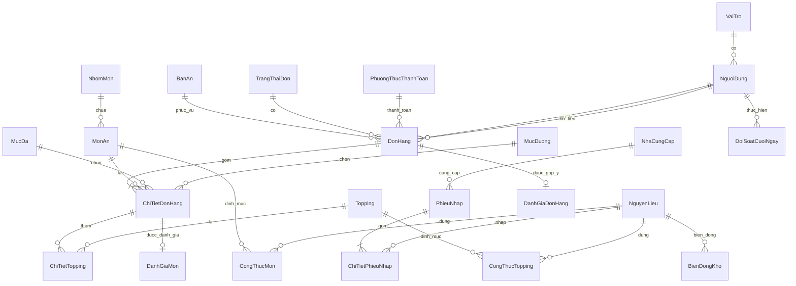

# Kế hoạch dự án: Website quản lý và đặt món qua mã QR theo thời gian thực (mô hình MIXUE)

**Công nghệ:** C# - ASP.NET Core MVC (.NET 8), Entity Framework Core, SQL Server, SignalR.
**Giao diện:** HTML (Razor View), CSS, JavaScript thuần (không dùng framework JS).
**Công cụ:** Visual Studio 2022 (workload "ASP.NET and web development") và SQL Server / LocalDB.

## 1. Ba nhóm người dùng

| Nhóm | Đăng nhập | Việc chính |
|---|---|---|
| Khách hàng | Không | Xem giới thiệu quán, quét QR tại bàn, chọn món (đá, đường, topping), gửi đơn, theo dõi trạng thái đơn trực tiếp, đánh giá món và quán, xem điểm và số người đánh giá của từng món |
| Thu ngân (kiêm pha chế) | Có | Nhận đơn mới theo thời gian thực, nhận đơn và làm, báo sẵn sàng, giao khách, thu tiền |
| Quản lý (kiêm thủ kho) | Có | Xem doanh thu, quản lý món/topping/bàn/QR/nhân viên, công thức món, nhập kho, kiểm kê, xem sổ kho và lịch sử đơn |

Quản lý cũng dùng được bảng đơn của thu ngân.

## 2. Kiến trúc MVC và cấu trúc thư mục

| Thành phần | Nơi đặt | Ghi chú |
|---|---|---|
| Model (thực thể) | `MoHinh/ThucThe.cs` | Ánh xạ 1-1 với bảng SQL |
| ViewModel | `MoHinh/ViewModels.cs` | Dữ liệu riêng cho từng trang |
| Controller | `Controllers/` | `TrangChu`, `ThucDon`, `DonHang`, `TaiKhoan`, `ThuNgan`, `QuanLy` |
| View (HTML) | `Views/` | Razor: `_Layout` cho khách, `_StaffLayout` cho nhân viên |
| CSS | `wwwroot/css/site.css` | Tông đỏ Mixue, xanh trời, vàng kem |
| JavaScript | `wwwroot/js/` | `thucdon.js` (giỏ hàng), `theodoi.js`, `thungan.js`, `nhanvien.js` |
| Truy cập dữ liệu | `DuLieu/DuLieuContext.cs` | EF Core, kết nối SQL Server |
| Dịch vụ | `DichVu/DichVuKho.cs` | Trừ kho theo công thức |
| Thời gian thực | `HubThoiGianThuc/DonHangHub.cs` | SignalR |
| Bảo mật | `TroGiup/MaHoaMatKhau.cs` | SHA-256 kèm muối |
| CSDL | `Database/MixueDatMonDb.sql` | Tạo bảng, view, dữ liệu mẫu theo menu |

Quy ước đặt tên: bảng, cột, lớp, thuộc tính, biến, hàm dùng tiếng Việt không dấu (ví dụ `DonHang`, `MaTheoDoi`, `TongTien`). Khóa chính bắt đầu bằng `Ma` (mã).

## 3. Cơ sở dữ liệu (chuẩn 3NF)

**Vì sao đạt 3NF**

- **1NF:** mọi cột là giá trị đơn. Món trong đơn nằm ở `ChiTietDonHang`, topping của từng món nằm ở `ChiTietTopping`, không nhét danh sách vào một cột.
- **2NF:** các bảng có khóa ghép (`ChiTietTopping`, `CongThucMon`, `CongThucTopping`) chỉ chứa cột phụ thuộc vào toàn bộ khóa (giá topping, lượng dùng).
- **3NF:** không có cột phụ thuộc bắc cầu. Tên trạng thái, tên phương thức thanh toán, mức đá, mức đường, vai trò, nhóm món nằm ở bảng riêng và được tham chiếu bằng mã. Tổng tiền đơn là dữ liệu suy diễn nên không lưu thành cột, mà tính bằng view `vw_TongTienDonHang`.
- `DonGia` trong `ChiTietDonHang` và `ChiTietTopping` cố ý lưu giá tại thời điểm bán để lịch sử không đổi khi quản lý sửa giá món. Đây là dữ liệu lịch sử, không phải dư thừa.
- `SoLuongTon` trong `NguyenLieu` là số dư hiện tại, được cập nhật cùng lúc với một dòng trong `BienDongKho` (sổ kho) để đối soát.

### 3.1. Chức năng đánh giá

| Thành phần | Mô tả |
|---|---|
| `DanhGiaMon` | Khách chấm 1-5 sao và nhận xét cho từng dòng món trong đơn. Cột `MaChiTiet` là UNIQUE nên mỗi dòng món chỉ được đánh giá một lần |
| `DanhGiaDonHang` | Đánh giá chung về quán / dịch vụ và góp ý cải thiện, mỗi đơn một lần |
| `vw_ThongKeDanhGiaMon` | View tính số lượt và điểm trung bình mỗi món (dữ liệu suy diễn nên không lưu cột, giữ 3NF). Món của một đánh giá lấy qua `ChiTietDonHang`, không lặp `MaMonAn` |

- Khách chỉ đánh giá được đơn của chính mình, từ trang theo dõi đơn, khi đồ đã **Sẵn sàng** hoặc **Hoàn thành**. Server kiểm tra dòng món thuộc đúng đơn và chưa được đánh giá.
- Thực đơn và trang chủ hiển thị ★ điểm trung bình kèm "(N đánh giá)". Bấm vào để xem phân bố số sao và nhận xét gần đây.
- Quản lý có trang **Đánh giá của khách**: điểm về quán, điểm từng món (món thấp nhất ở đầu), góp ý theo số sao, đánh dấu đã xem, ẩn nhận xét không phù hợp (nhận xét bị ẩn không tính vào điểm).

### 3.2. Bảng đơn gọn, lịch sử đơn và đối soát cuối ngày (thu ngân)

- **Bảng đơn** chỉ giữ: đơn đang xử lý (Chờ xác nhận, Đang làm, Sẵn sàng), đơn **vừa xong hoặc vừa hủy trong 30 phút gần nhất**, và đơn đã giao trong ngày nhưng **chưa thu tiền** (để không bị bỏ sót). Đơn cũ hơn chuyển sang trang **Lịch sử đơn**.
- **Lịch sử đơn**: tra cứu đơn mọi ngày, lọc theo khoảng ngày, trạng thái, đã/chưa thu tiền, mã đơn hoặc tên khách; thu tiền bù cho đơn còn thiếu ngay trong trang.
- **Đối soát cuối ngày**: tổng doanh thu theo ngày, tách tiền mặt và chuyển khoản, bảng 7 ngày gần nhất, danh sách từng khoản thu (giờ, mã đơn, hình thức, người thu) để tick đối chiếu, danh sách đơn chưa thu tiền và số đơn hủy.
- **Kiểm đếm tiền mặt**: thu ngân nhập tiền lẻ đầu ca và tiền thực đếm; hệ thống so với `tiền lẻ đầu ca + tiền mặt thu trong ngày` và báo Khớp / Thừa / Thiếu. Kết quả được lưu ở bảng `DoiSoatCuoiNgay` (số tiền mặt hệ thống do server tự tính lại để không sửa được từ trình duyệt). Chênh lệch là dữ liệu suy diễn nên không lưu thành cột.
- Doanh thu đối soát tính theo **ngày thu tiền** vì đây là ngày tiền thực sự vào két hoặc tài khoản. Cột `DonHang.MaNguoiThuTien` ghi lại ai thu.
- Đơn đã thu tiền **không được hủy** (tránh lệch doanh thu và tiền trong két). Trường hợp hoàn tiền cho khách cần báo quản lý xử lý riêng.

## 4. Luồng nghiệp vụ

1. Khách quét QR `https://<địa chỉ quán>/t/<MaQr>` và hệ thống nhớ bàn trong session.
2. Khách chọn món, giỏ hàng lưu ở trình duyệt, bấm "Gửi đơn". Server tra lại giá từ CSDL, không tin giá do trình duyệt gửi.
3. Đơn lưu ở trạng thái **Chờ xác nhận**. SignalR phát sự kiện `CoDonMoi` cho nhóm `nhanvien` và bảng đơn của thu ngân hiện thẻ đơn mới (kèm âm báo nếu bật).
4. Thu ngân bấm **Nhận đơn và làm** để chuyển sang **Đang làm**, đồng thời trừ kho theo công thức trong một giao dịch.
5. Thu ngân bấm **Xong, gọi khách** để chuyển sang **Sẵn sàng**, rồi **Đã giao khách** để **Hoàn thành**. Có thể thu tiền (tiền mặt / chuyển khoản) ở bất kỳ bước nào.
6. Mỗi lần đổi trạng thái, SignalR phát `TrangThaiThayDoi` tới nhóm `don-<MaTheoDoi>` và màn hình khách cập nhật ngay, có đồng hồ dự phòng 30 giây nếu mất mạng.

Chuyển trạng thái hợp lệ: Chờ xác nhận → Đang làm hoặc Đã hủy; Đang làm → Sẵn sàng hoặc Đã hủy; Sẵn sàng → Hoàn thành. Server kiểm tra lại nên hai thu ngân bấm cùng lúc không trừ kho hai lần.

## 5. Bảo mật đã làm

- Mật khẩu: `SHA-256(muối + mật khẩu)`, muối 16 byte ngẫu nhiên riêng từng người, so sánh bằng `FixedTimeEquals`. Đăng nhập sai bị làm chậm 0,5 giây.
- Phân quyền theo vai trò bằng `[Authorize(Roles = ...)]`: khu Thu ngân cho `ThuNgan` và `QuanLy`, khu Quản lý chỉ cho `QuanLy`.
- Chống CSRF: mọi POST đều kiểm tra token chống giả mạo (form và fetch đều gửi token).
- Mã QR chứa chuỗi ngẫu nhiên 128-bit, không dùng số bàn; quản lý có thể đổi mã khi cần.
- Giá, số lượng, tùy chọn đều kiểm tra lại phía server; chuỗi khách nhập được cắt độ dài; nội dung hiển thị trong JS được escape.
- Tệp tải lên chỉ nhận `.jpg/.png/.webp` dưới 2MB, đặt tên ngẫu nhiên.

**Lưu ý cho bản chạy thật:** SHA-256 là hàm băm nhanh, nên với dữ liệu thật hãy chuyển sang PBKDF2 (`Rfc2898DeriveBytes`) hoặc BCrypt/Argon2 (chỉ cần thay 3 hàm trong `MaHoaMatKhau.cs`). Nên bổ sung khóa tài khoản sau nhiều lần đăng nhập sai và giới hạn tần suất gửi đơn từ một thiết bị.

## 6. Lộ trình

| Giai đoạn | Nội dung | Trạng thái |
|---|---|---|
| 1. Nền tảng | CSDL 3NF, EF Core, đăng nhập/đăng xuất, phân quyền | Đã có mã |
| 2. Khách hàng | Trang chủ giới thiệu, thực đơn, giỏ hàng, gửi đơn, theo dõi đơn | Đã có mã |
| 3. Thu ngân | Bảng đơn thời gian thực, đổi trạng thái, thu tiền | Đã có mã |
| 4. Quản lý và kho | Tổng quan doanh thu, món, topping, bàn/QR, nhân viên, công thức, nhập kho, kiểm kê, sổ kho, lịch sử đơn | Đã có mã |
| 5. Kiểm thử | Chạy thử toàn bộ trên Visual Studio, sửa lỗi phát sinh, thay ảnh món thật, chỉnh topping và giá theo quán | Cần làm khi bạn chạy |
| 6. Mở rộng (tùy chọn) | Mã giảm giá, in bill, thanh toán VietQR, báo cáo xuất Excel, quản lý nhóm món, công thức topping trên giao diện, tổng đài gọi nhân viên | Chưa làm |

## 7. Danh sách kiểm thử khi chạy thử

- Quét QR bàn 1 rồi đặt món, kiểm tra thẻ đơn hiện "Bàn 1" trên máy thu ngân mà không cần tải lại.
- Đặt món kem (không có đá/đường) và món trà (có topping), kiểm tra tổng tiền khớp với giá trên bảng giá.
- Thu ngân bấm từng bước trạng thái, kiểm tra màn hình khách đổi theo.
- Kiểm tra kho giảm đúng sau khi bấm "Nhận đơn và làm", và sổ kho có dòng "Xuất theo đơn".
- Hủy đơn khi đang "Đang làm": kho không hoàn lại (vì nguyên liệu đã dùng).
- Đăng nhập bằng tài khoản thu ngân rồi thử vào `/QuanLy/TongQuan`, phải bị từ chối.
- Đổi mã QR của bàn và quét QR cũ, phải báo mã không hợp lệ.
- Tắt mạng điện thoại 10 giây rồi bật lại, trang theo dõi phải tự cập nhật.
- Hoàn thành và thu tiền một đơn, đợi hơn 30 phút (hoặc sửa hằng `SoPhutHienDonVuaXong` xuống 1 để thử): đơn phải biến mất khỏi bảng và xuất hiện ở Lịch sử đơn.
- Đơn Hoàn thành nhưng chưa thu tiền phải vẫn nằm trên bảng, và có trong danh sách "chưa thu tiền" của Đối soát.
- Thu tiền vài đơn bằng tiền mặt và chuyển khoản, mở Đối soát: tổng tiền mặt, tổng chuyển khoản và tổng doanh thu phải khớp với các đơn đã thu.
- Nhập tiền thực đếm bằng, lớn hơn và nhỏ hơn số hệ thống để xem thông báo Khớp / Thừa / Thiếu, rồi lưu và kiểm tra dòng lưu hiện ở phần "Các lần đối soát đã lưu".
- Thử hủy đơn đã thu tiền: hệ thống phải từ chối.
- Đặt một đơn, đưa đơn tới trạng thái Sẵn sàng, kiểm tra khu "Bạn thấy hôm nay thế nào?" hiện ra trên máy khách rồi gửi đánh giá.
- Tải lại trang theo dõi: các mục đã chấm phải chuyển thành dạng chỉ xem, không gửi lại được.
- Vào thực đơn, món vừa được đánh giá phải hiện điểm và số lượt; bấm vào xem nhận xét.
- Ở trang quản lý, ẩn một nhận xét rồi kiểm tra điểm và số lượt của món giảm tương ứng.
